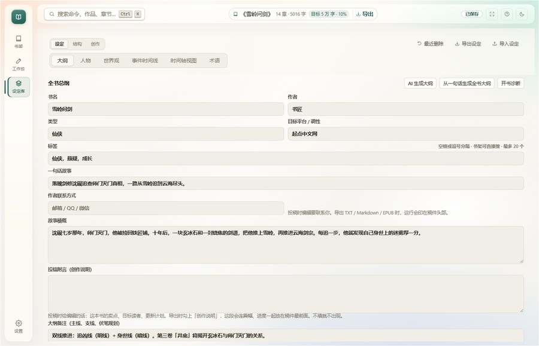

<p align="center">
  
</p>

<h1 align="center">书匠</h1>

<p align="center"><b>完全跑在自己电脑上的中文长篇小说创作台</b></p>

<p align="center">AI 起稿 · 续写 · 润色 · 设定库 · 大纲 · 一致性检查 · 一键导出</p>

<p align="center">
  <a href="https://github.com/MistHowlJade/shujiang/releases/latest"></a>
  <a href="LICENSE"></a>
  <a href="https://github.com/MistHowlJade/shujiang/actions"></a>
  
  
</p>

<p align="center">
  <a href="https://github.com/MistHowlJade/shujiang/releases/download/v1.0.26/ShuJiang-Portable-1.0.26.exe"></a>
  <a href="https://github.com/MistHowlJade/shujiang/releases/download/v1.0.26/ShuJiang-1.0.26-win-x64.zip"></a>
  <a href="RELEASE_NOTES.md"></a>
</p>

<p align="center">
  
</p>

<p align="center"><sub>写作台：左章节 / 中正文 / 右 AI 助手。AI 结果先停在输出区，确认后才写进正文。</sub></p>

---

## 概览

书匠把长篇写作真正会用到的东西收进一个本地应用：正文编辑器、AI 生成本章与续写、设定库、分卷大纲、章纲、人物关系、一致性检查、文字校对、版本历史、EPUB / Word / PDF 导出。所有作品都是本机 `data/` 下的普通 JSON 文件。

| 原则 | 说明 |
| --- | --- |
| **本地优先** | 作品、设定、密钥只存在本机；除你自己配置并主动触发的模型接口，应用不发出任何外部请求。没有遥测，没有云端同步。 |
| **运行时零依赖** | 不装任何 npm 包，服务端只用 Node 内置模块；删掉文件夹就是卸载干净。 |
| **数据可带走** | 一部作品一个 JSON，整个 `data/` 复制走就是完整备份；也可以单本导出 JSON 备份换机恢复。 |
| **不做黑盒** | AI 输出是草稿，不会自动覆盖正文；替换前自动留版本历史，所有导出都是标准格式。 |

当前版本 **v1.0.26**，修复了 24 个导入导出与写作流程问题。完整清单见 [RELEASE_NOTES.md](RELEASE_NOTES.md)。

---

## 下载

发布页：<https://github.com/MistHowlJade/shujiang/releases>

| 文件 | 说明 |
| --- | --- |
| **ShuJiang-Portable-1.0.26.exe** | 单文件便携版（主推）。解压 / U 盘随身，不用安装 |
| **ShuJiang-1.0.26-win-x64.zip** | 绿色版（备用）。解压到任意目录，双击 `书匠.exe` 运行 |

- 便携版不往系统安装目录写东西；作品数据在 exe 旁边的 `data/`，搬走时一起带走
- 发布包**没有代码签名**，第一次运行 SmartScreen 会提示：点「更多信息 → 仍要运行」
- 安装版（NSIS）已经停止发布，便携版和绿色 zip 是唯一形态

---

## 开始使用

### 桌面版

1. 下载上面的便携版 exe，双击运行。
2. 空书架会给三条路：**一键开书**、**手动新建**、**导入旧稿**。也可以点「先看看示例作品」，在本地复制一部《雪岭问剑》逛功能，不联网、不花 API 费用。
3. 第一次点 AI 按钮时，应用会就地引导你接模型：选服务商、填 Key、拉取模型列表。补好后自动回到刚才的操作。
4. 写作、生成、检查、导出。数据随时保存在本机。

### 源码版

需要 Node 18+。项目里如果有 `tools\node\node.exe`（便携 Node），可以直接用它，不必另装。双击 `启动.bat`，或手动运行：

```bat
tools\node\node.exe server\server.js
```

启动后浏览器会自动打开 `http://127.0.0.1:8848`。关掉命令行窗口就是停止服务。服务已经在运行时再次启动，只会重新打开浏览器，不会起第二个实例写 `data/`。

| 环境变量 | 作用 |
| --- | --- |
| `SHU_PORT` | 指定端口，默认 8848；被占用时自动 +1 |
| `SHU_NO_OPEN=1` | 启动后不自动打开浏览器 |
| `SHU_UPSTREAM_IDLE` | 等模型的超时毫秒数，默认 180000 |
| `SHU_DATA_DIR` | 指定数据目录（测试、便携、多份数据时用） |

---

## 功能

### 写作

- **三栏工作台**：章节、正文、AI 助手同屏；窄屏自动收成抽屉。
- **自动保存**：停止输入 0.6 秒落盘，`Ctrl+S` 立即保存；保存失败会明确提示。
- **生成本章 / 续写**：按章纲、设定、前文和本章要求生成；结果先放输出区，可追加、替换或插入光标处。
- **批量生成**：从当前章往后连续出草稿，每章停下来等你确认，不覆盖已有正文。
- **段落操作**：选中正文可润色、扩写、精简、改写或按指令修改，结果左右对照，确认后才替换。
- **模型对比**：两个模型跑同一段上下文，左右并排流式输出；差异视图可切「改动 / A 版 / B 版」，满意哪边就采用哪边。
- **辅助工具**：专注模式、写作冲刺计时器、章节目标、场景卡片、章节看板、AI 对话、上下文预览。

### 设定与大纲

- **大纲**：分卷 + 章纲（场景、出场人物、核心事件、章末钩子），可拖拽排序；「作品信息」放书名、作者、类型、标签、简介、联系方式和投稿附言。
- **人物**：人物卡、关键词、关系、出场索引、人物弧光；关系图谱和弧光都有独立视图。
- **世界观**：地理、势力、规则、物品等条目，支持提及检索和状态变化归并。
- **时间线**：事件列表与时间轴视图，按章节关联。
- **线索 / 伏笔**：跨章汇总，能看出哪些线索还没收。
- **结构/节拍**：Save the Cat 视图。
- **文风与规则**：文风要求、禁用表达、写作口吻、全书目标字数。
- **其他**：灵感库、术语表、生成记录、揭示计划。

### 检查与校对

优先在本地计算，不消耗 token：

- **文字校对**：错别字、标点、常见表达问题，按章出清单，可忽略。
- **全书体检**：字数曲线、重复表达、对话比例、拖沓段落、章节节奏。
- **一致性检查**：设定冲突、时间线矛盾、人物行为、口吻漂移、姓名笔误。
- **交稿检查**：作者、简介、联系方式、未定稿章节、篇幅、材料是否齐全，导出前就能跑。
- **读者视角检查**（可选，调用模型）：爽点档、毒点检查、断章评估、敏感内容提醒、结构检查。
- **章节记忆**：把本章人物、伏笔、状态存成结构化记忆，后续生成自动带上，也可以批量补。

### 导入与导出

**导入**：`.txt` / `.md` / `.docx`，单文件上限 20 MB。

- 自动识别 UTF-8、UTF-16 LE/BE、GBK / GB18030
- 认「第1章 / 第一章 / 第 1 回」、序章 / 楔子 / 番外等写法，以及「第X卷」分卷
- Word 只读正文，跳过书名页和创作说明；修订删除的不导入、修订插入的保留
- 导入是追加到现有章节末尾；导入的正文不计入今日码字量

**导出**：

| 格式 | 适合 |
| --- | --- |
| TXT | 投稿、纯文本分发 |
| Markdown | 自己存档、二次编辑 |
| Word（.docx） | 交给编辑，每章另起一页、带页码 |
| EPUB | 手机 / 阅读器，自动生成目录和分卷 |
| 打印稿 / PDF | 浏览器打印或另存 PDF，A4、书名页、分卷页 |
| JSON 备份 | 换机与灾难恢复，正文、设定、大纲、记忆、批注、自定义封面都在里面 |

导出时可选章节区间、只导出定稿章节（有定稿也有未定稿时默认如此）、附带全书大纲和人物小传、把投稿附言放在最前面，以及给 EPUB 选封面版式 / 配色 / 上传自己的封面图（PNG / JPG / GIF，8 MB 以内）。

> Markdown 导出会带几行 `<!-- shujiang:frontmatter -->` 之类的注释，用于回导时跳过前置页和附录；它们在预览里不可见，旧版导出文件也能识别。

### 阅读、版本与恢复

- **阅读模式**：翻章、目录、字号、全书进度；读到要改的地方点「去写这一章」直接回到正文。书架卡片也能直接进阅读模式。
- **版本历史**：每 10 分钟自动备份，AI 替换正文、删除章节前也会备份；可对比、可只恢复本章正文，恢复前再存一份。
- **回收站**：删作品先进回收站，可恢复或彻底删除。
- **JSON 备份**：导出时把自定义封面图内嵌，换机恢复不丢封面。

### 检索与导航

- `Ctrl+K` 命令面板：跳章节、切页面、导出、体检、校对，所有操作都能搜到；最近用过的命令置顶。
- `Ctrl+F` 全书查找 / 替换；`Ctrl+Shift+F` 跨作品全局检索。
- 书架、章节、设定库、阅读目录、版本历史都支持多词搜索，忽略大小写。

---

## 界面

<table width="100%">
  <tr>
    <td width="50%" align="center"><br><sub>书架：全书目标、日更进度、继续阅读</sub></td>
    <td width="50%" align="center"><br><sub>设定库：作品信息与全书大纲</sub></td>
  </tr>
  <tr>
    <td width="50%" align="center"><br><sub>人物卡与人物关系</sub></td>
    <td width="50%" align="center"><br><sub>分卷与章纲：拖拽排序、进度、章纲编辑</sub></td>
  </tr>
</table>

---

## 模型接入

应用不绑定模型服务商，任何兼容 OpenAI 接口的服务都能用：DeepSeek、阿里通义、Kimi、智谱 GLM、火山方舟（豆包）、OpenAI、Ollama 本地，以及各种中转站。

各家「OpenAI 兼容」实现并不一致，服务端已经把常见偏差抹平：

| 情况 | 处理 |
| --- | --- |
| 无视 `stream: true`，直接回完整 JSON | 自动识别并当作一次输出 |
| `delta.content` 是 `[{type,text}]` 数组 | 自动拼接 |
| 思考字段叫 `reasoning` / `reasoning_text` | 显示在「思考中」折叠区 |
| SSE 用 CRLF、带 `: ping`、事件被 TCP 切开 | 正常解析 |
| 流里夹错误帧、空 `choices`、`usage` | 错误照实转达，空帧忽略 |
| 网关回 200 但内容是网页 / JSON 错误体 | 抽出一句人话，不把 HTML 写进稿子 |
| 401 / 额度用尽 / 模型名不对 / 长时间无响应 | 分别提示查 Key、额度、模型名、地址；超时按 `SHU_UPSTREAM_IDLE` 断开 |

想联网看风向时，可以在服务商设置里开启「联网搜索」，让模型自己联网（通义 `enable_search`、Gemini `google_search`、OpenRouter `web` 插件，或自定义 JSON）。应用自己不爬网站。

**离线调试**：启动假模型，不联网、不花钱跑通全流程。

```bat
tools\node\node.exe dev\mock-openai.js
```

Base URL 填 `http://127.0.0.1:8890/v1`，Key 随便填，模型用 `mock-writer` / `mock-alt` / `mock-reasoner` / `mock-error`。还提供一组模拟接口异常的模型（`mock-json`、`mock-array`、`mock-crlf`、`mock-split`、`mock-html`、`mock-quota`、`mock-stall` 等），启动时终端会列出。假模型只用于验证流程，不能当真稿。

---

## 数据与隐私

```text
data/
  config.json            服务商、密钥、生成参数、稿纸排版
  stats.json             每日码字量与日更目标
  novels/
    n_xxxxxx.json        一部作品一个文件：设定 + 全部章节
  covers/
    n_xxxxxx.png         自定义封面（没有就自动生成，不落盘）
  backups/
    n_xxxxxx/            版本历史快照
  trash/                 回收站
```

- 除你自己配置并主动触发的模型请求，应用不发出任何外部请求；没有遥测、没有统计上报、没有云端同步。
- 密钥只在本机 `config.json`，不随作品导出。
- 备份：整个 `data/` 复制走即可；换机复制回来就是完整恢复。
- 作品和密钥是明文 JSON，能读硬盘的人就能读。这是本地优先的取舍：不提供同步、云备份或加密保险箱。
- 删除作品先进回收站；彻底删除才会清理正文、设定和该作品的版本备份。

---

## 快捷键

<details>
<summary>展开完整快捷键</summary>

| 按键 | 作用 |
| --- | --- |
| `Ctrl + K` | 命令面板 |
| `Ctrl + F` | 全书查找 / 替换 |
| `Ctrl + Shift + F` | 跨作品全局检索 |
| `Ctrl + Z` | 撤销（连续打字算一步，AI 写入各自一步） |
| `Ctrl + Shift + Z` / `Ctrl + Y` | 重做 |
| `Ctrl + Enter` | 续写当前章 |
| `Ctrl + Shift + Enter` | 生成本章 |
| `Ctrl + S` | 立即保存 |
| `Ctrl + Shift + E` | 导出 |
| `Ctrl + Alt + S` | 写作冲刺计时器 |
| `Ctrl + Alt + F` | 专注写作模式 |
| `Ctrl + Alt + B` | 章节看板 |
| `Alt + ↑` / `Alt + ↓` | 上一章 / 下一章 |
| `Ctrl + Alt + =` / `Ctrl + Alt + -` | 放大 / 缩小稿纸字号 |
| `Ctrl + Alt + 0` | 稿纸恢复默认 |
| `←` / `→` | 阅读模式翻章 |
| `T` | 阅读模式打开目录 |
| `/` | 书架搜索框 |
| `Esc` | 关闭当前层（阅读 / 目录 / 弹窗 / 命令面板 / 专注） |

</details>

---

## 开发

运行时只用 Node 内置模块；`devDependencies` 里只有 `electron` 和 `electron-builder`，仅用于打包。

| 命令 | 作用 |
| --- | --- |
| `npm start` | 浏览器版，`http://127.0.0.1:8848` |
| `npm run desktop` | Electron 桌面版 |
| `npm run mock` | 假模型（默认 8890） |
| `npm run regress` | 回归自检（318 项；假模型没起时 311 项） |
| `npm test` | lib 层单元测试（640 项） |
| `npm run check-refs` | 模块引用自检 |
| `npm run perf` | 性能压测 |
| `npm run dist` | 便携版打包 |

跑回归时先起服务，三个窗口或后台运行：

```bat
:: 窗口 1：本地服务
tools\node\node.exe server\server.js

:: 窗口 2（可选）：假模型，跑满模型相关检查
tools\node\node.exe dev\mock-openai.js

:: 窗口 3：回归
tools\node\node.exe dev\regress.mjs
```

自检开始时会记下书架和回收站里原有的作品，结束只删自己建的，并反查「原有作品一部都没少」；测试写入的字数也会还原，不搅乱真实日更记录。测试请用 `SHU_DATA_DIR=.tmp-regress-data` 隔离，不要往 `data/` 里写。

页面质量：Lighthouse 的 Accessibility / Best Practices / SEO 均为 100。500 章 / 150 万字的大稿实测：打开整本约 280 ms，切章 1–2 ms，服务端接口基本在 100 ms 以内。

<details>
<summary>项目结构</summary>

```text
server/     HTTP 服务、SSE 转发、导入导出、提示词、JSON 存储
  server.js   路由与文件 I/O
  store.js    存储层
  context.js  上下文组装（相关度检索 + 预算裁剪）
  prompts.js  全部任务提示词
  epub.js / docx.js / print.js / zip.js / cover.js / manuscript.js
web/        原生 JS 前端（无构建步骤）
  app.js      主逻辑
  lib/        纯计算模块：校对 / 体检 / 一致性 / 差异 / 目标 / 排版
  index.html / style.css
electron/   桌面版主进程（单进程内嵌服务端）
dev/        假模型、回归、lib 测试、性能、EPUB 检查、图标生成
build/      icon.png / icon.ico
```

</details>

---

## 桌面版打包

| 命令 | 作用 |
| --- | --- |
| `npm install` | 只装 electron + electron-builder |
| `npm run desktop` | 预览桌面版 |
| `npm run pack` | 只出 `dist/win-unpacked` |
| `npm run dist` | 出便携版 exe |

Electron 主进程把零依赖服务端嵌入进来，动态选择空闲端口，单实例运行，只允许访问本应用地址。

数据目录解析顺序：`SHU_DATA_DIR` > 本体同目录的 `data/` > 老位置 `%APPDATA%\书匠\data`（已有数据的老用户继续使用旧目录，避免两份数据分家）。

---

## 常见问题

**浏览器打不开或提示端口被占用？**  
8848 被占用时服务会自动换到 8849，看命令行窗口里打印的地址。

**提示「未配置模型」？**  
去「设置」添加服务商并保存。密钥要填在当前激活的服务商上，模型名也要选对。

**字数怎么算的？**  
去掉空白和换行后的字符数，中文按字算。

**AI 写得太「AI」怎么办？**  
设置 →「拆书 · 提取文风」，粘贴喜欢的文字，提炼后写进当前作品的文风档案（需要先打开一部作品）；写作时再补一句具体要求。

**从旧稿导入后章节不对？**  
确认标题是不是「第X章 / 第X卷 / 序章」这类常见格式；导入是追加，不会覆盖已有章节。

**换电脑怎么搬？**  
整个 `data/` 复制走，或用「导出 → 作品备份（JSON）」单本迁移。恢复会在书架新建一部，不覆盖现有作品。

**为什么 exe 有 100 多 MB？**  
里面是 Electron 自带的 Chromium；应用本身不到 1 MB。

---

## 许可

MIT，见 [LICENSE](LICENSE)。

发布包未签名，SmartScreen 提示时点「更多信息 → 仍要运行」。所有发行版都可以从本仓库源码用 `npm run dist` 自行构建验证。

- 作者：MistHowlJade
- 问题与建议：<https://github.com/MistHowlJade/shujiang/issues>