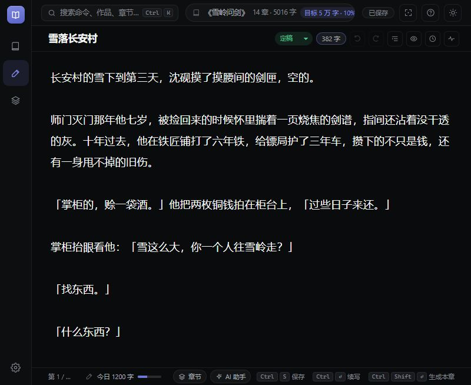
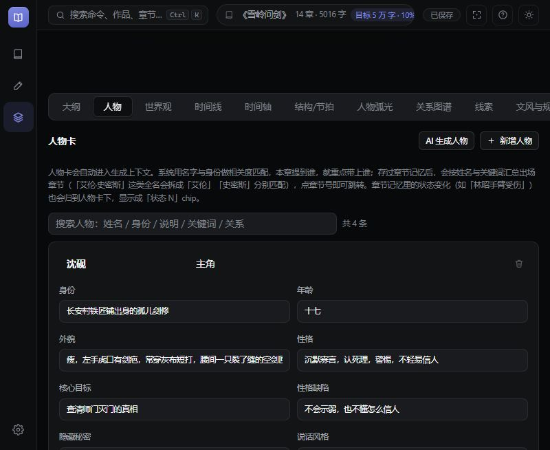

# 书匠

完全本地运行的中文长篇小说创作台。AI 辅助起稿、续写与润色，作品、设定与版本历史都保存在本机 `data/`；除你配置并主动触发的模型接口外，不发出任何网络请求。

**本地优先 · 运行时零依赖 · 数据可迁移**

当前版本 **v1.0.31**，[更新记录](RELEASE_NOTES.md) · [下载](https://github.com/MistHowlJade/shujiang/releases/latest)

## 界面

<table width="100%">
  <tr>
    <td width="50%" align="center"><br><sub>书架：全书目标、日更进度、继续阅读</sub></td>
    <td width="50%" align="center"><br><sub>工作台：章节、正文、AI 助手</sub></td>
  </tr>
  <tr>
    <td width="50%" align="center"><br><sub>设定库：人物卡与关系</sub></td>
    <td width="50%" align="center"><br><sub>分卷与章纲：拖拽排序、章纲编辑</sub></td>
  </tr>
</table>

## 下载

| 文件 | 大小 | 说明 |
| --- | --- | --- |
| [ShuJiang-Portable-1.0.31.exe](https://github.com/MistHowlJade/shujiang/releases/download/v1.0.31/ShuJiang-Portable-1.0.31.exe) | 105 MB | 单文件便携版，无需安装 |
| [ShuJiang-1.0.31-win-x64.zip](https://github.com/MistHowlJade/shujiang/releases/download/v1.0.31/ShuJiang-1.0.31-win-x64.zip) | 155 MB | 绿色版，解压后运行 `书匠.exe` |

系统要求：Windows 10 / 11；源码模式需要 Node.js 18+。发布包未签名，首次运行时 Windows SmartScreen 会提示，选择「更多信息 → 仍要运行」即可。便携版不写入系统安装目录，作品数据位于 exe 同级的 `data/`。

## 快速开始

1. 下载并运行便携版。
2. 在空书架选择 **一键开书**、**手动新建** 或 **导入旧稿**；也可先复制示例作品《雪岭问剑》了解功能。
3. 首次使用 AI 时，按提示选择服务商、填写 API Key 并获取模型列表。
4. 写作、检查、导出。AI 结果先停在输出区，确认后才写入正文；所有内容实时保存到本机。

源码模式：双击 `启动.bat`，或运行：

```bat
tools\node\node.exe server\server.js
```

常用环境变量：`SHU_PORT`（端口，默认 8848）、`SHU_NO_OPEN=1`（不自动开浏览器）、`SHU_UPSTREAM_IDLE`（模型超时毫秒）、`SHU_DATA_DIR`（数据目录）。

## 功能

| 模块 | 内容 |
| --- | --- |
| 写作 | 三栏工作台、自动保存、生成本章、续写、批量生成、模型对比、段落润色 / 扩写 / 精简 / 改写、专注模式、章节看板 |
| 设定 | 分卷与章纲、人物卡、关系图谱、人物弧光、世界观、时间线、线索、结构节拍、文风与规则 |
| 检查 | 文字校对、全书体检、一致性检查、交稿检查；可选读者视角检查（爽点 / 毒点 / 断章 / 敏感内容） |
| 导入 | TXT / Markdown / Word，自动识别 UTF-8、UTF-16、GBK / GB18030，按「第X章」「第X卷」切分 |
| 导出 | TXT、Markdown、Word、EPUB、打印稿 / PDF、JSON 备份；支持章节区间、仅定稿、附带大纲与人物小传 |
| 阅读与版本 | 阅读模式、版本历史、回收站；JSON 备份含正文、设定、大纲、记忆、批注和自定义封面 |
| 检索 | `Ctrl+K` 命令面板、全书查找 / 替换、跨作品全局检索 |

## 模型

支持任何兼容 OpenAI Chat Completions 接口的服务，包括 DeepSeek、通义、Kimi、智谱、豆包、OpenAI、Ollama 本地服务和各类中转站。非流式返回、数组式 `delta`、`reasoning` 字段、SSE 拆包、错误帧等常见差异已在服务端处理；401、额度不足、模型名错误和超时会分别给出提示。

联网搜索由你配置的模型提供（通义 `enable_search`、Gemini `google_search`、OpenRouter `web` 插件或自定义参数），应用本身不抓取网页。

离线调试可启动假模型，不联网、不产生费用：

```bat
tools\node\node.exe dev\mock-openai.js
```

Base URL 填 `http://127.0.0.1:8890/v1`，API Key 任意，模型选 `mock-writer`、`mock-alt`、`mock-reasoner` 或 `mock-error`。假模型仅用于流程验证。

## 数据与隐私

```text
data/
  config.json            服务商、密钥、生成参数、稿纸排版
  stats.json             每日码字量与日更目标
  novels/                单部作品一个 JSON：设定 + 全部章节
  covers/                自定义封面
  backups/               版本历史快照
  trash/                 回收站
```

- 除你配置并主动触发的模型请求外，应用不发出任何外部请求。
- 密钥只在本机 `config.json`，不随作品导出。
- 复制整个 `data/` 目录即可完成备份或迁移。
- 作品与密钥以明文 JSON 存储，不提供云同步或加密保险箱。

## 开发

运行时零依赖；`devDependencies` 仅含 `electron` 与 `electron-builder`，用于打包。

| 命令 | 作用 |
| --- | --- |
| `npm start` | 浏览器版，`http://127.0.0.1:8848` |
| `npm run desktop` | Electron 桌面版 |
| `npm run mock` | 假模型服务，默认 8890 |
| `npm run regress` | 回归测试，322 项（未启动假模型时 315 项） |
| `npm test` | lib 单元测试，641 项 |
| `npm run check-refs` | 模块引用检查 |
| `npm run dist` | 构建便携版 |

运行回归前先启动服务：

```bat
:: 终端 1
tools\node\node.exe server\server.js

:: 终端 2（可选）
tools\node\node.exe dev\mock-openai.js

:: 终端 3
tools\node\node.exe dev\regress.mjs
```

测试请用 `SHU_DATA_DIR=.tmp-regress-data` 隔离，不要往真实 `data/` 写。

## 常见问题

**AI 会覆盖正文吗？** 不会。生成结果先停在输出区，点「追加 / 替换 / 插入」才写入；替换前自动留版本历史，`Ctrl+Z` 可撤销。

**浏览器打不开或端口被占用？** 8848 被占用时服务会切换到 8849，看命令行窗口输出的地址。

**提示「未配置模型」？** 在设置中添加服务商并保存，确认密钥在当前激活的服务商上、模型名正确。

**如何减少 AI 文风？** 设置 →「拆书 · 提取文风」，把提炼结果写进当前作品的文风档案（需先打开作品）。

**如何换电脑？** 复制整个 `data/` 目录，或导出 JSON 备份迁移单部作品；恢复会新建作品，不覆盖现有数据。

## 许可

MIT，见 [LICENSE](LICENSE)。发布包未签名，SmartScreen 提示时选择「更多信息 → 仍要运行」。所有发行版均可由本仓库源码通过 `npm run dist` 构建验证。

问题与建议：<https://github.com/MistHowlJade/shujiang/issues>